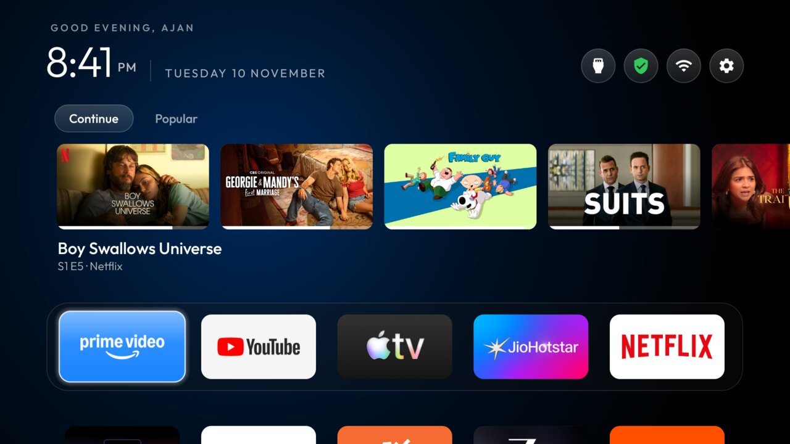
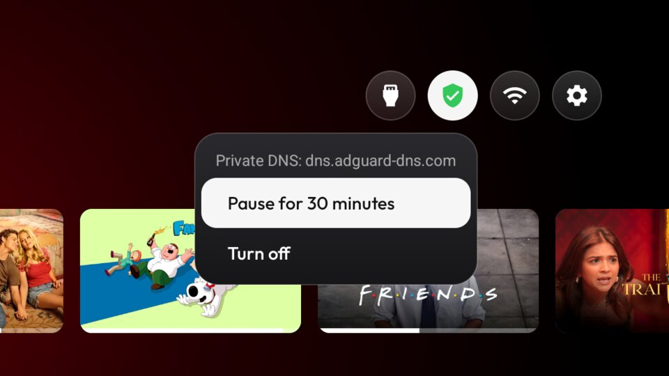
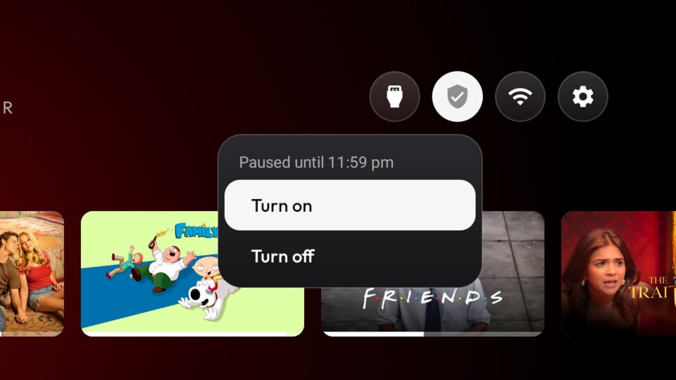
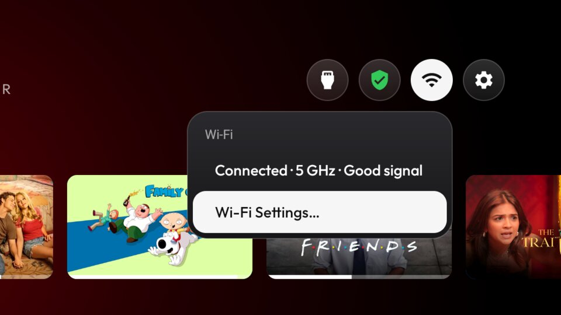

# cleanyourtv-foryou

A variant of [CleanYourTV](https://github.com/Gathin23/cleanyourtv)'s launcher with a **For You** row and a few
remote and screensaver fixes for Google TV. The debloat tools, lists and everything else are CleanYourTV's, unchanged:
start with its [README](README.md) and [PROMPT.md](PROMPT.md).

Tested on a **Sony BRAVIA VU31** (Google TV 14, build UKR1.240726.001, India). Other Google TV sets should work but
haven't been tried.



*Home on the test TV, November 2026: the **For You** row on its Continue tab, with progress bars, the green **Private DNS shield** next to Wi-Fi, icon-only top buttons, and the dock without app titles.*

## What this variant adds

| Feature | What it does | Turn it off |
|---|---|---|
| **For You** row above the dock | Two tabs, **Continue** and **Popular**, filled only from your **dock apps** (see below). OK opens that exact title or episode in its app. The big app name above the dock (`dock_title`) is off to make room. It shows with **0 rows below the dock**; with 1 to 3 rows (Launcher settings) the dock rises and the row hides itself rather than cover the clock and the top buttons. While a card is focused, its artwork, softly blurred and darkened, fills the background behind Home; it fades back to the wallpaper when you leave the row. | `for_you` false (and `dock_title` true) in `config.xml` |
| **Screensaver starts after** | A row in Launcher settings (hold OK on the gear → Launcher settings): 1, 5, 10, 15 or 30 minutes. Google TV has no on-screen setting for this. | remove the row's code, or just don't use it |
| **Update bell** in the top bar | A round bell, styled like the other top buttons, appears left of Inputs only while the Play Store has app updates waiting (with the stock launcher disabled nothing else shows them). OK opens them in the Play Store. | `update_bell` false in `config.xml` |
| **Private DNS shield** in the top bar | Only when Private DNS is in strict mode (for example `dns.adguard-dns.com`): a round shield left of the network pill. **Green**: a fresh name lookup answers. **Amber**: still waiting. In strict mode lookups hang for about a minute after the TV wakes from standby (measured on the test TV), and an app opened then can stay on "Can't connect" until it is force-stopped. **Red**: no answer for two minutes. Status only (focus skips it) unless installed with `DNS_SWITCH=1`: then OK on it offers **Pause for 30 minutes** (AdGuard comes back by itself; the menu shows "Paused until 11:51 PM"), **Turn off** and **Turn on**, and while off it stays as a grey shield. Otherwise hidden with Private DNS off or automatic. | `dns_shield` false in `config.xml` |
| **Remote app buttons** row in Launcher settings | **On**: the remote's YouTube, Netflix, Prime Video and Settings buttons work, and a held volume key moves one step per press (Sony drops key repeats while the helper filters keys). **Off**: holding volume ramps again (on the test TV, Volume + held 3 s went 22 to 39), and those buttons do nothing. Takes effect at once, and switching it Off shows a short message saying which buttons stop working; a theme push resets it to `key_filter`. | don't use it; `key_filter` sets the default |
| **Wi-Fi menu** | OK on the Wi-Fi icon opens a small glass menu, like Inputs, instead of going straight to Settings: connected or not, the band (2.4 / 5 GHz), signal strength and whether the internet works, then **Wi-Fi Settings…**. Without Location on, Android hides the network's name and the nearby networks from apps, and no app may switch networks since Android 10, so choosing a network is still done in Wi-Fi Settings. | the pill's long press still opens Wi-Fi settings directly |
| **Down in the screensaver** | Opens Ambient mode's own *Screensaver settings* panel, as the stock Google TV home did. | `dream_down_component` empty in `config.xml` |
| Remote buttons (Sony VU31 defaults) | `app_keys`: YouTube (201/202), Netflix (191), Prime Video (189) and the **Settings** button (83), which do nothing once the stock launcher is disabled. | edit `app_keys` for your remote |

### The top-bar menus

| Private DNS shield (AdGuard on) | Paused for 30 minutes | Wi-Fi |
|---|---|---|
|  |  |  |

The shield's menu needs `DNS_SWITCH=1` at install (see Permissions below); without it the shield is a status light.

### Where For You gets its cards

Everything comes from what your dock apps publish to Android TV itself; there is **no outside service, account or
API key**:

- **Continue**: Android TV's *Watch Next* list (in progress, next episode, new episode), newest first, with progress
  bars. On the test TV: Netflix, Prime Video and JioHotstar publish it; Apple TV and YouTube don't.
- **Popular**: each dock app's own recommendation row (for example Prime Video, JioHotstar's *Top Picks For You*,
  Apple TV, YouTube's *Recommended for you*), taken from each app in turn so no app fills the row. Netflix publishes
  no row. Duplicate rows are removed; YouTube Music is skipped.
- Change `dock_apps` and the tabs follow.

## Permissions and network use

The original launcher has no network access and no extra permissions, by design. This variant adds:

| Permission | Why | Granted by |
|---|---|---|
| `INTERNET` | Download the **artwork links the apps themselves publish**, only while Home is on screen; cached on the TV (at most 150 pictures). Nothing else is sent anywhere. | install |
| `READ_TV_LISTINGS` | Read Watch Next and the apps' rows on the TV | `variant-install.sh` (`pm grant`) |
| `WRITE_SETTINGS` | The *Screensaver starts after* row writes Android's screensaver delay | `variant-install.sh` (`appops`) |
| `WRITE_SECURE_SETTINGS` (opt-in) | Only with `DNS_SWITCH=1`: the shield's menu switches Private DNS (`private_dns_mode`). **Broad**: it allows changing any secure or global setting; the launcher uses it for nothing else. Upstream's install revokes it by default | `variant-install.sh` with `DNS_SWITCH=1` (`pm grant`) |
| Notification access | The update bell reads **only** the Play Store's "updates available" notifications; every other notification is ignored and nothing is stored | `variant-install.sh` (`cmd notification allow_listener`) |

## Install

1. Debloat and set up ADB with CleanYourTV's [PROMPT.md](PROMPT.md) or README, as usual.
2. Edit `launcher/app/src/main/res/values/config.xml`: at least `dock_apps` (your apps, in order) and, if you like,
   `greeting_name` (for "GOOD EVENING, <NAME>"). A theme's `config.json` can set `greeting_name` too, without a rebuild.
3. Build and install (JDK 17, Android SDK 34): `TV_HOST=<tv ip> ./variant-install.sh` (add `DNS_SWITCH=1` for the shield's Private DNS menu)
4. Switch USB debugging off again and restart the TV; `tools/adb-closed.py <tv ip>` should report the port closed.

## Known limits

- Opening a card needs the app to publish a link; every entry on the test TV did.
- Artwork needs internet; without it the cards show the app's name on its colour.
- On the test TV, holding volume moves one step per press while the remote helper filters keys (switch it with the Remote app buttons row): the key-repeat trade in
  [docs/devices/tcl-55p71b-g09-key-repeat.md](docs/devices/tcl-55p71b-g09-key-repeat.md).

- With Private DNS in strict mode, give the TV a moment after waking: the shield turns green when lookups work.
  If an app was opened too early and says it can't connect, force-stop it (Settings → Apps) instead of restarting.

## Staying up to date with CleanYourTV

This repository keeps CleanYourTV's full history. To bring in its updates:

```bash
git remote add upstream https://github.com/Gathin23/cleanyourtv.git   # once
git fetch upstream
git merge upstream/main          # resolve any conflicts in the launcher files, rebuild, test on the TV
```

The changed code is marked `Local change (not upstream)`: `ForYou.java`, `ArtCache.java`, `ForYouAdapter.java`,
`AppUpdates.java`, `UpdateWatchService.java`, `ic_bell.xml`, `DnsShield.java`, `ic_shield.xml`,
`item_foryou.xml`, and sections of `MainActivity.java`, `InputKeyService.java` and `LauncherSettingsActivity.java`.

## Credits and licence

- [CleanYourTV](https://github.com/Gathin23/cleanyourtv) by Gathin23 and its contributors: the debloat tools and the
  launcher this is built on. MIT, see [LICENSE](LICENSE).
- The update bell's idea comes from [Talkies](https://github.com/rajupp/talkies) and [Matinee](https://github.com/Jarvis322/matinee) (both MIT).
- The idea of a Continue row from Watch Next and the apps' rows comes from
  [Talkies](https://github.com/rajupp/talkies) (MIT); the code here is written for this launcher.
- This variant is released under the same MIT licence.
